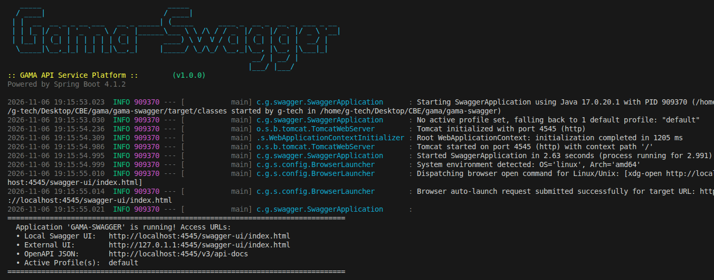
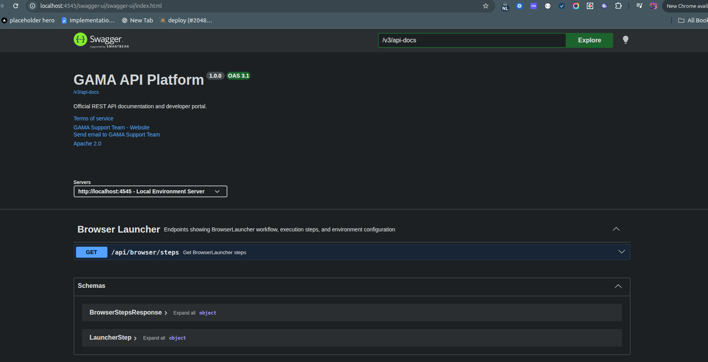

# 🚀 Spring Boot Swagger UI Auto-Launcher (`BrowserLauncher`)


> Automatically opens Swagger UI in your system's default browser as soon as your Spring Boot application boots up — across **Windows**, **macOS**, and **Linux**, with robust headless and Desktop API fallbacks.

🔗 **GitHub Repository**: [YOUR GITHUB LINK](https://github.com/your-username/spring-boot-swagger-launcher)

---

## 🌟 Why This Exists

Tired of typing `http://localhost:4545/swagger-ui/index.html` every single time you restart your local Spring Boot backend? 

`BrowserLauncher` is a lightweight, zero-boilerplate `CommandLineRunner` component that detects your operating system and automatically launches your configured Swagger UI endpoint. If CLI tools are missing or the server is headless, it handles fallbacks gracefully without interrupting your application lifecycle.

---

## ⚡ Features

- 🖥️ **Cross-Platform OS Detection**: Detects Windows, macOS, and Linux/Unix platforms dynamically at startup.
- 🛡️ **Graceful Fallbacks**:
  - **Windows**: Executes `cmd /c start "" <url>`
  - **macOS**: Executes `open <url>`
  - **Linux / Unix**: Uses `xdg-open <url>` (with automatic `which` pre-check), with seamless fallback to `java.awt.Desktop.browse(...)`.
  - **Headless Servers / CI/CD**: Safely suppresses GUI errors without throwing startup exceptions.
- ⚙️ **Configurable**: Toggle auto-open on/off via `openProject.isOpen` and customize the target URL via `application.yml`.
- 📊 **Step Diagnostic Endpoint**: Includes a REST API (`GET /api/browser/steps`) exposing runtime status and execution flow.
- 🎨 **Enterprise ANSI Logging**: Clean, colorized logs with informative diagnostic metrics and custom banner art.

---

## 📸 Screenshots

### 🖥️ Console Startup & Environment Detection
Colorized ANSI startup logs displaying banner art, host environment detection (OS & Architecture), and the browser launch command dispatch:



### 🌐 Auto-Launched Swagger UI
The default system browser automatically opens to the Swagger UI API documentation page upon application bootstrap:



---

## ⚙️ Configuration (`application.yml`)

Configure the launcher and your custom Swagger UI settings in `src/main/resources/application.yml`:

```yaml
spring:
  application:
    name: GAMA-SWAGGER
  output:
    ansi:
      enabled: ALWAYS

server:
  port: ${SERVER_PORT:4545}

# Browser Auto-Launcher Configuration
openProject:
  isOpen: true
  web:
    openUrl: "http://localhost:${server.port}/swagger-ui/index.html"

# SpringDoc OpenAPI Documentation Customization
springdoc:
  api-docs:
    path: /v3/api-docs
    version: OPENAPI_3_1
  swagger-ui:
    path: /swagger-ui/index.html
    tags-sorter: alpha
    operations-sorter: method
    display-request-duration: true

# Professional & Colorful Logging
logging:
  pattern:
    console: "%clr(%d{yyyy-MM-dd HH:mm:ss.SSS}){faint} %clr(%5p) %clr(${PID:- }){magenta} %clr(---){faint} %clr([%15.15t]){faint} %clr(%-35.35logger{30}){cyan} %clr(:){faint} %m%n%wEx"
  level:
    root: INFO
    org.springdoc: ERROR
    org.apache.catalina: WARN
    com.gama.swagger: INFO
```

---

## 💻 The `BrowserLauncher` Component

Here is the complete implementation of `BrowserLauncher.java`:

```java
package com.gama.swagger.config;

import org.slf4j.Logger;
import org.slf4j.LoggerFactory;
import org.springframework.beans.factory.annotation.Value;
import org.springframework.boot.CommandLineRunner;
import org.springframework.stereotype.Component;

import java.awt.Desktop;
import java.net.URI;
import java.util.Locale;

@Component
public class BrowserLauncher implements CommandLineRunner {

    private static final Logger log = LoggerFactory.getLogger(BrowserLauncher.class);

    @Value("${openProject.isOpen:true}")
    private boolean isOpen;

    @Value("${openProject.web.openUrl}")
    private String openUrl;

    @Override
    public void run(String... args) {
        if (!isOpen) {
            log.info("Browser auto-open is disabled via configuration (openProject.isOpen=false).");
            return;
        }

        String os = System.getProperty("os.name", "").toLowerCase(Locale.ROOT);
        String arch = System.getProperty("os.arch", "");
        log.info("System environment detected: OS='{}', Arch='{}'", os, arch);

        try {
            if (os.contains("win")) {
                log.info("Dispatching browser open command for Windows: [cmd /c start \"\" {}]", openUrl);
                Runtime.getRuntime().exec(new String[]{"cmd", "/c", "start", "", openUrl});
            } else if (os.contains("mac")) {
                log.info("Dispatching browser open command for macOS: [open {}]", openUrl);
                Runtime.getRuntime().exec(new String[]{"open", openUrl});
            } else if (os.contains("nux") || os.contains("nix") || os.contains("aix")) {
                // Linux / Unix
                if (isCommandAvailable("xdg-open")) {
                    log.info("Dispatching browser open command for Linux/Unix: [xdg-open {}]", openUrl);
                    Runtime.getRuntime().exec(new String[]{"xdg-open", openUrl});
                } else {
                    log.warn("Command 'xdg-open' not found in system PATH. Attempting Java Desktop API fallback...");
                    fallbackDesktopBrowse();
                }
            } else {
                log.warn("Unrecognized OS '{}' — attempting Java Desktop API fallback...", os);
                fallbackDesktopBrowse();
            }
            log.info("Browser auto-launch request submitted successfully for target URL: {}", openUrl);
        } catch (Exception e) {
            log.warn("Could not auto-open browser: {}", e.getMessage());
        }
    }

    private void fallbackDesktopBrowse() {
        try {
            if (Desktop.isDesktopSupported()
                    && Desktop.getDesktop().isSupported(Desktop.Action.BROWSE)) {
                log.info("Opening target URL via Java Desktop API: {}", openUrl);
                Desktop.getDesktop().browse(new URI(openUrl));
                log.info("Browser successfully opened via Desktop.browse fallback.");
            } else {
                log.warn("Headless environment or Desktop browsing not supported. Please open manually: {}", openUrl);
            }
        } catch (Exception ex) {
            log.warn("Desktop.browse fallback failed: {}", ex.getMessage());
        }
    }

    private boolean isCommandAvailable(String cmd) {
        try {
            Process p = new ProcessBuilder("which", cmd)
                    .redirectErrorStream(true)
                    .start();
            return p.waitFor() == 0;
        } catch (Exception e) {
            return false;
        }
    }
}
```

---

## 📡 Diagnostic REST API (`GET /api/browser/steps`)

Want to inspect the steps or verify the detected host environment programmatically? The project includes `BrowserLauncherController`:

```bash
curl -X GET "http://localhost:4545/api/browser/steps"
```

### Sample JSON Response

```json
{
  "component": "BrowserLauncher (CommandLineRunner)",
  "description": "Automatically opens the configured Swagger UI URL in the default system browser upon application startup.",
  "configuration": {
    "openProject.isOpen": true,
    "openProject.web.openUrl": "http://localhost:4545/swagger-ui/index.html"
  },
  "currentEnvironment": {
    "detectedOs": "linux",
    "isHeadless": false,
    "isDesktopSupported": true,
    "isXdgOpenAvailable": true,
    "selectedExecutionBranch": "Linux/Unix: xdg-open http://localhost:4545/swagger-ui/index.html"
  },
  "steps": [
    {
      "step": 1,
      "name": "Check Enablement Flag",
      "condition": "if (!isOpen)",
      "action": "Verify whether browser auto-launch is enabled via property 'openProject.isOpen'.",
      "details": "If isOpen is false, logs 'Auto-open browser disabled' and exits run() method immediately."
    },
    {
      "step": 2,
      "name": "Operating System Detection",
      "condition": "System.getProperty(\"os.name\", \"\").toLowerCase(Locale.ROOT)",
      "action": "Inspect system OS properties to determine the host environment platform.",
      "details": "Identifies whether current system matches Windows ('win'), macOS ('mac'), or Linux/Unix ('nux', 'nix', 'aix')."
    },
    {
      "step": 3,
      "name": "OS-Specific Browser Launch Command",
      "condition": "Platform branch matching detected OS",
      "action": "Dispatches the appropriate CLI command via Runtime.getRuntime().exec().",
      "details": "Windows: ['cmd', '/c', 'start', '', openUrl] | macOS: ['open', openUrl] | Linux/Unix: verifies 'which xdg-open', then executes ['xdg-open', openUrl] if found."
    },
    {
      "step": 4,
      "name": "Desktop API Fallback (fallbackDesktopBrowse)",
      "condition": "xdg-open missing on Linux, or unrecognized OS",
      "action": "Attempts to use Java AWT Desktop.getDesktop().browse(new URI(openUrl)).",
      "details": "Checks Desktop.isDesktopSupported() and Desktop.Action.BROWSE. If headless or unsupported, logs manual URL instruction."
    },
    {
      "step": 5,
      "name": "Error Handling and Logging",
      "condition": "try-catch (Exception e)",
      "action": "Catches process execution or browser launch exceptions to protect application lifecycle.",
      "details": "Logs warnings with error message without failing the Spring Boot application startup."
    }
  ]
}
```

---

## 🛠️ Getting Started

### Prerequisites
- **Java 17** or higher
- Terminal with Bash or CMD / PowerShell

### Build and Run

```bash
# Clone the repository
git clone [YOUR GITHUB LINK]
cd swagger

# Compile and run test suite
./mvnw clean test

# Start the Spring Boot application
./mvnw spring-boot:run
```

Once started:
1. Your default web browser will automatically open: `http://localhost:4545/swagger-ui/index.html`
2. Raw OpenAPI 3.1 definitions are available at: `http://localhost:4545/v3/api-docs`

---

## 📋 Configuration Reference

| Property | Default Value | Description |
| :--- | :--- | :--- |
| `openProject.isOpen` | `true` | Toggle automatic browser launch on or off |
| `openProject.web.openUrl` | `http://localhost:${server.port}/swagger-ui/index.html` | Target URL to open in browser |
| `server.port` | `4545` | Application HTTP server port |
| `springdoc.api-docs.path` | `/v3/api-docs` | Path for OpenAPI raw specification JSON |
| `springdoc.api-docs.version` | `OPENAPI_3_1` | Specification version (`OPENAPI_3_1` or `OPENAPI_3_0`) |

---

## 📄 License

This project is open-source and licensed under the [MIT License](LICENSE).

